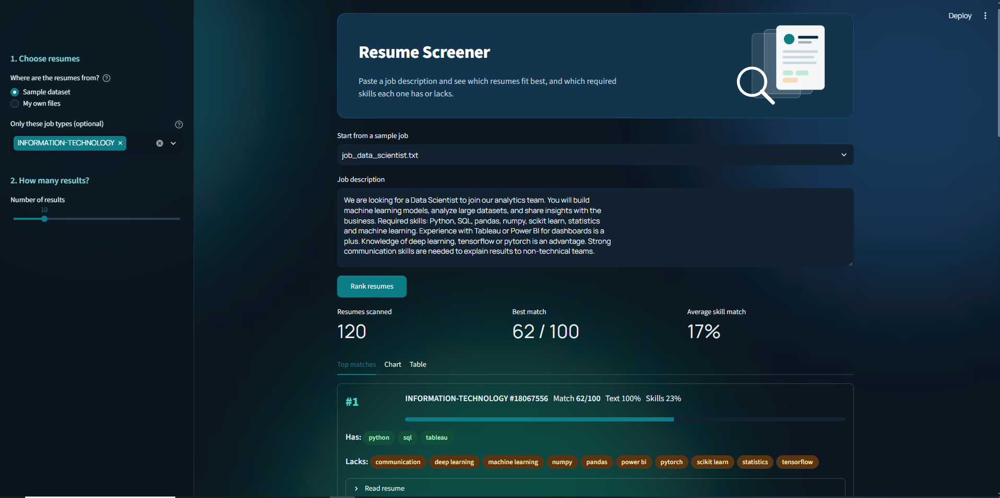

# Resume Screener

A tool that ranks resumes against a job description and shows which required skills each resume has or lacks.

Paste a job description, pick your resumes, and get a ranked list with a score from 0 to 100 for each one.

## Screenshots



## Features
- Rank resumes against any job description
- See matched skills (green) and missing skills (orange) for each resume
- Use the sample dataset (about 2,500 resumes) or upload your own PDF or TXT files
- Filter the sample dataset by job type
- Dark themed web app built with Streamlit
- Fast ranking: the slow work is done once and reused for every search

## How it works
Each resume gets two scores. They are mixed 50/50 into one final score.

1. **Text match.** TF-IDF turns the job and each resume into numbers. Cosine similarity then measures how close they are. This looks at all the words.
2. **Skill match.** spaCy finds known skills (from a list in `src/skills.py`) in the job and in each resume. The score is the share of the job's skills that the resume has.

Final score = 50% text match + 50% skill match, shown from 0 to 100.

## Tech
Python, pandas, scikit-learn, spaCy, pdfplumber, Streamlit

## Dataset
[Kaggle Resume Dataset](https://www.kaggle.com/datasets/snehaanbhawal/resume-dataset)
Download it and place `Resume.csv` inside the `data/` folder.

## How to run
1. Install the libraries:
   ```
   pip install -r requirements.txt
   python -m spacy download en_core_web_sm
   ```
2. Put `Resume.csv` inside the `data/` folder.
3. Start the app from the project folder:
   ```
   streamlit run app.py
   ```
4. The first search takes about a minute because the app prepares all resumes. After that, each search takes about a second.

## Project structure
```
resume-screener/
├── app.py              # Streamlit app
├── requirements.txt    # libraries to install
├── src/
│   ├── cleaning.py     # text cleaning
│   ├── skills.py       # skill list and skill matching
│   └── matching.py     # TF-IDF matching
├── notebooks/
│   └── explore.ipynb   # data exploration
├── data/               # dataset and sample job descriptions
├── screenshots/        # app screenshots for this README
├── .streamlit/
│   └── config.toml     # dark theme
└── README.md
```

## Limits
- The skill match only knows the skills in the list in `src/skills.py`. If a job uses skills that are not in the list, the app uses text match only. The list covers tech, HR, sales and finance skills, so jobs in other fields (for example aviation) need more skills added.
- TF-IDF matches words, not meaning. "Software engineer" and "programmer" are not seen as similar.
- The dataset has no Data Science category, and most IT resumes are about IT support. Programming jobs therefore match weakly.
- Scores are relative. The best resume in a search always shows 100% text match, so a high score does not mean a perfect candidate.
- Resumes can contain bias. This tool is a learning project and should not be used to make real hiring decisions.

## Privacy
Do not upload real resumes to this repository. PDFs are ignored by `.gitignore`.

## Plan
- [x] Set up project and load data
- [x] Explore data and clean resume text
- [x] Extract skills with spaCy
- [x] Match resumes to job using TF-IDF
- [x] Build Streamlit app
- [x] Add screenshots
- [ ] Add more skills for other fields
- [ ] Improve matching with sentence embeddings